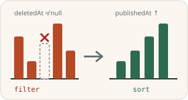
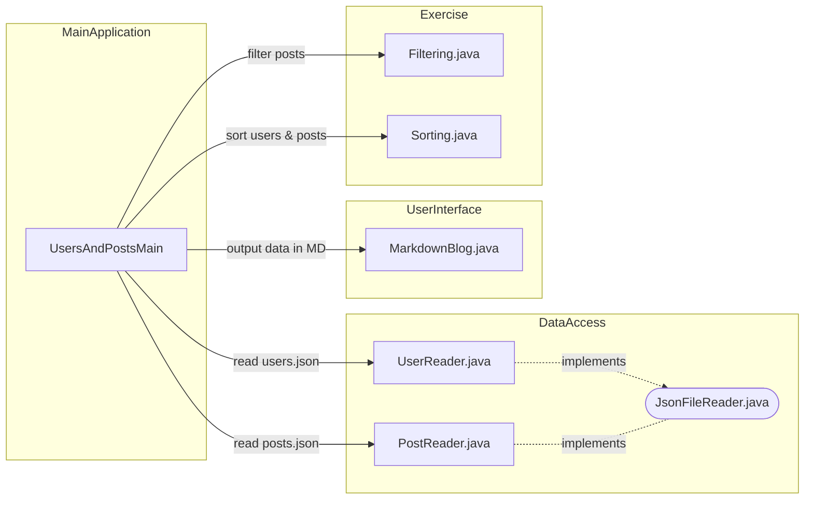
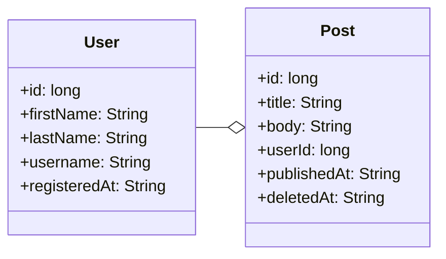

# Tietorakenteet ja algoritmit: filter ja sort



Tässä tehtävässä perehdytään Java-olioista koostuvien listojen suodattamiseen ja lajitteluun eri attribuuttien perusteella. Tavoitteena on opetella tiettyjä algoritmeja ja tietorakenteita sekä tehdä koodista testattavaa ja uudelleenkäytettävää.

## Tehtävän aloittaminen

Forkkaa ensin tämä repositorio omaan GitHub-repositorioosi GitHubin **Fork**-painikkeella ja kloonaa vasta sitten oma forkkisi koneellesi:

```sh
git clone https://github.com/<oma-github-tunnuksesi>/8-sorting-and-filtering.git
```

Avaa kloonattu projekti koodieditorissasi.

Koodieditorisi asentaa projektin riippuvuudet ([Gson](https://github.com/google/gson/) JSON-tiedostojen käsittelyyn ja [JUnit](https://junit.org/) testeihin) todennäköisesti automaattisesti, kun avaat projektin ensimmäisen kerran. Ne on määritetty [build.gradle](./build.gradle)-tiedostoon, ja voit asentaa ne myös komennolla `./gradlew install` (Windowsissa `.\gradlew.bat install`).

## Testaaminen

Tehtävän osille on valmiit [JUnit](https://junit.org/)-yksikkötestit hakemistossa [src/test/java](./src/test/java/). Kunkin osan kohdalla kerrotaan, millä testiluokalla se arvioidaan. Voit ajaa testit koodieditorisi testaustyökalulla ([VS Code](https://code.visualstudio.com/docs/java/java-testing), [Eclipse](https://www.vogella.com/tutorials/JUnitEclipse/article.html)) tai [Gradlella](https://docs.gradle.org/current/userguide/java_testing.html), esimerkiksi:

```
./gradlew test --tests FilteringDeletedPostsTest        # unix
.\gradlew.bat test --tests FilteringDeletedPostsTest    # windows
```

Lisää komennon loppuun `--info`, jos haluat tarkemmat tiedot epäonnistuneista testeistä. Testien tekniseen toteutukseen ei tarvitse perehtyä, ja voit kokeilla ratkaisuasi myös omalla `main`-metodilla. Saat kirjoittaa omia testejä lisää, mutta älä muuta tai poista valmiita testejä.

Älä muuta valmiiden luokkien, metodien ja konstruktorien nimiä, parametreja tai paluuarvojen tyyppejä, sillä silloin testit eivät käänny. Saat tiedoston alkuperäisen version takaisin komennolla `git restore <tiedoston polku>` tai kurssijärjestelmän **Palauta lähtökoodi** -toiminnolla.

## Palauttaminen ja pisteet

Jokaisella tehtävän osalla on kurssijärjestelmässä (https://jtjuslin.kapsi.fi/java) oma sivunsa, jonka koodikentissä on osan koodipohja. Kopioi ratkaisusi koodikenttiin tai kirjoita se suoraan niihin. **Testaa ilman palautusta** ajaa osan testit tallentamatta pisteitä, ja **Lähetä** palauttaa ratkaisun. Jokainen testiluokka hyväksytään vain, jos sen kaikki testit menevät läpi, ja pisteet jaetaan hyväksyttyjen testiluokkien mukaan.

**Pisteet kahdessa vaiheessa**

1. Kun ratkaisusi menee läpi kurssijärjestelmässä, saat osasta **puolet pisteistä**.
2. Pushaa lopuksi kaikki julkiseen GitHub-repositorioosi. Paina tämän jälkeen osan sivulla **Lähetä tarkistettavaksi** -nappia. Kun testit menevät läpi, saat osasta **täydet pisteet**. Repositorio saa jäädä julkiseksi.

GitHubissa ei ole arvioivaa YAML-tehtävävirtaa (GitHub Actions -workflowta), eikä `git push` käynnistä arviointia. Kun painat **Lähetä tarkistettavaksi**, kurssijärjestelmän botti hakee koodisi repositoriostasi ja tarkistaa sen samoilla testeillä. Molemmat vaiheet pitää tehdä ennen luvun määräaikaa. Voit lähettää ratkaisusi niin monta kertaa kuin tarvitset, ja voimaan jää paras tulos.


## Pääohjelma ja ohjelman rakenne

Valmis pääohjelma [UsersAndPostsMain](./src/main/java/app/UsersAndPostsMain.java) tulostaa käyttäjät ja heidän julkaisunsa. Tulosteet ovat aluksi virheelliset, ja esimerkiksi jokaisen käyttäjän kohdalla tulostuvat samat otsikot, mutta ne korjaantuvat sitä mukaa kuin ratkaiset tehtävän osia. Suorita ohjelma koodieditorisi Run-painikkeella tai komennolla `./gradlew run` (Windowsissa `.\gradlew.bat run`). Tuloste on esimerkiksi seuraava:

```
# Isac Isodate (2022-07-16T22:57:59.361Z)
- TypeScript for dummies
  2023-06-30T05:30:54.612Z
- This post was published in 2021 and deleted in 2023
  2021-07-11T05:33:06.104Z 2023-07-21T23:53:01.586Z

# Ursula Unixdate (1638589047)
- There are different types of secrets.
  2023-09-01T10:02:19.997Z
- This was published in 2023 and has not been deleted
  2023-07-13T09:33:37.100Z
```

Jokaisen käyttäjän kohdalla tulostetaan siis nimi ja rekisteröitymisaika sekä jokaisen julkaisun otsikko, julkaisuaika ja mahdollinen poistoaika. Pääohjelmaa ei tarvitse muuttaa, mutta saat muuttaa sitä esimerkiksi ohjelman toiminnan tutkimiseksi 👍.

Ohjelma on jaettu useisiin luokkiin ja metodeihin, jotta eri toiminnot voidaan yksikkötestata ja käyttää uudelleen. Sinun tarvitsee muokata vain luokkia [Filtering](./src/main/java/exercise/Filtering.java) ja [Sorting](./src/main/java/exercise/Sorting.java):




## Tehtävän data

Tehtävän JSON-muotoinen esimerkkidata on peräisin [dummyjson.com](https://dummyjson.com)-palvelusta: tiedostot [users.json](./data/users.json) ja [posts.json](./data/posts.json) on ladattu [DummyJSON-projektin GitHub-repositoriosta](https://github.com/Ovi/DummyJSON/blob/master/src/data/). Tätä tehtävää varten julkaisuihin on lisätty attribuutit `publishedAt` ja `deletedAt` ja käyttäjiin `registeredAt`:

```diff
 {
   "id": 5,
   "title": "Hopes and dreams were dashed that day.",
   "body": "Hopes and dreams were...",
   "userId": 41,
   "reactions": 2,
+  "publishedAt": "2023-06-01T08:07:20.410Z",
+  "deletedAt": "2023-06-14T02:16:08.513Z"
 }
```

```diff
 {
   "id": 1,
   "firstName": "Terry",
   "lastName": "Medhurst",
   "username": "terrmed",
+  "registeredAt": "2022-07-16T22:57:59.361Z"
 }
```

Dataa vastaavat [Post](./src/main/java/model/Post.java)- ja [User](./src/main/java/model/User.java)-luokat ovat [model](./src/main/java/model/)-paketissa. Ne on toteutettu [record](https://dev.java/learn/records/)-tyyppisinä, koska ne vain varastoivat tietoa. JSON-tiedostojen lukeminen on toteutettu valmiiksi [PostReader](./src/main/java/json/PostReader.java)- ja [UserReader](./src/main/java/json/UserReader.java)-luokissa Googlen Gson-kirjastolla. **Sinun ei tarvitse käsitellä tiedostoja, käyttää Gsonia eikä luoda uusia `Post`- tai `User`-olioita.**


## Tehtävä

Yrityksenne tuoteomistaja Maxwell Goldgrabber on kirjoittanut sinulle oheisen fiktiivisen saateviestin. [TL;DR](https://en.wikipedia.org/wiki/TL;DR) 🥱: voit hypätä viestin yli suoraan tehtävän osiin.

> Subject: RE: RE: RE: RE: Users and posts
>
> Dear developer,
>
> I hope this message finds you well. We have some critical tasks ahead that require your immediate attention. These tasks are not only essential for our product's success but also for my quarterly bonus, which is directly tied to their successful completion.
>
> * Task 1: *filterOutDeletedPosts*. We've received complaints from our customers about deleted posts appearing in the listings. When the users delete their posts, we don't actually remove them, but we do a [soft delete and just mark the data as deleted](https://www.google.com/search?q=soft+delete). It's absolutely crucial that posts with a *deletedAt* timestamp are filtered out without fail.
> * Task 2: *filterPostsByUser*. This method will ensure that we only show the given user's posts and do not mix posts from different users by mistake. Having this functionality in a separate method helps our testers conduct unit tests and other teams to reuse the code.
> * Task 3: *sortPostsByPublishedDate*. We need this function to sort posts by *publishedAt* by implementing [a sorting algorithm](https://en.wikipedia.org/wiki/Sorting_algorithm) ourselves. [There are many to choose from and some seem more complex than others](https://youtu.be/RfXt_qHDEPw).
> * Task 4: *sortUsersByRegistrationDate*. This method should sort users by their *registeredAt* date, accommodating different types of timestamps. **We appear to have a bit of technical debt in this field, as different users have their timestamps in different formats.**
>
> The urgency of these tasks cannot be overstated. On a lighter note, I've already made **a pre-order on a Tesla** 🚗, and my bonus 💰 from this quarter is playing a significant role in making that dream a reality. So, you can understand the importance of these tasks!!!1!
>
> Best regards,
>
> Maxwell Goldgrabber, Product Manager, Ohjelmointi 2 inc.
>
> *This email was written by ChatGPT*


## Osa 1: filterOutDeletedPosts *(perusteet, 10 %)*

Toteuta [Filtering](./src/main/java/exercise/Filtering.java)-luokan metodi `filterOutDeletedPosts`. Sen tulee palauttaa uusi lista, josta **puuttuvat** kaikki ne [Post](./src/main/java/model/Post.java)-oliot, joilla on asetettuna `deletedAt`-arvo. Streamit sopivat tähän hyvin.

Arvioinnissa ajetaan testiluokka [FilteringDeletedPostsTest](./src/test/java/exercise/FilteringDeletedPostsTest.java).


## Osa 2: filterPostsByUser *(perusteet, 20 %)*

Toteuta [Filtering](./src/main/java/exercise/Filtering.java)-luokan metodi `filterPostsByUser`. Se saa parametreinaan [User](./src/main/java/model/User.java)-olion ja listan [Post](./src/main/java/model/Post.java)-olioita ja palauttaa listan, jossa on vain annetun käyttäjän julkaisut. Julkaisu kuuluu käyttäjälle, kun sen `userId` on sama kuin käyttäjän `id`:



Kurssijärjestelmä tuo osan 1 `Filtering`-luokkasi tähän osaan automaattisesti, kun avaat sen ensimmäisen kerran.

Arvioinnissa ajetaan testiluokka [FilteringPostsByUserTest](./src/test/java/exercise/FilteringPostsByUserTest.java).


## Osa 3: sortPostsByPublishedDate *(soveltaminen, 40 %)*

Toteuta [Sorting](./src/main/java/exercise/Sorting.java)-luokan metodi `sortPostsByPublishedDate` niin, että se palauttaa uuden listan, jossa [Post](./src/main/java/model/Post.java)-oliot on **lajiteltu** julkaisuajan (`publishedAt`) mukaan kasvavaan järjestykseen **itse toteuttamallasi lajittelualgoritmilla**:

```java
public static List<Post> sortPostsByPublishedDate(List<Post> posts) {
    return posts; // TODO: Implement sorting logic
}
```

Lajittele **kokonaisia `Post`-olioita**, älä esimerkiksi pelkkiä otsikoita ja julkaisuaikoja. Annettua listaa tai sen olioita ei saa muuttaa. Saat toteuttaa apumetodeja ja lisätä metodeja `Post`-luokkaan.

📣 **Tavoitteena on toteuttaa itse jokin tunnettu lajittelualgoritmi, joten Javan valmiita sort-toteutuksia ei saa käyttää.**

💡 *Julkaisuajat ovat [ISO 8601](https://en.wikipedia.org/wiki/ISO_8601) -muotoisia merkkijonoja, esimerkiksi `"2023-06-01T08:07:20.410Z"`, joten niitä voi verrata "aakkosjärjestyksessä" `compareTo`-metodilla.*

**Lajittelualgoritmit.** Lajittelualgoritmit ovat logiikaltaan ohjelmointikielestä riippumattomia. Video [Sorting Algorithms Explained Visually (Beyond Fireship)](https://youtu.be/RfXt_qHDEPw) on hyvä 9 minuutin johdatus aiheeseen. Seuraaville algoritmeille löytyy myös hyvät Java-videotutoriaalit:

* Pikalajittelu eli [Quicksort](https://en.wikipedia.org/wiki/Quicksort): [YouTube (Coding with John)](https://www.youtube.com/watch?v=h8eyY7dIiN4)
* Lomituslajittelu eli [Merge Sort](https://en.wikipedia.org/wiki/Merge_sort): [YouTube (Coding with John)](https://www.youtube.com/watch?v=bOk35XmHPKs)
* Lisäyslajittelu eli [Insertion Sort](https://en.wikipedia.org/wiki/Insertion_sort): [YouTube](https://www.youtube.com/watch?v=0lOnnd50cGI)
* Kuplalajittelu eli [Bubble Sort](https://en.wikipedia.org/wiki/Bubble_sort): [YouTube (Coding with John)](https://www.youtube.com/watch?v=g8qeaEd2jTc)

Valitse algoritmi esimerkiksi tehokkuuden tai toteutuksen yksinkertaisuuden perusteella, ja kysy rohkeasti neuvoa. 🚀 *Jos haluat oppia mahdollisimman paljon uutta, valitse **rekursiivinen** algoritmi, kuten Quicksort tai Merge Sort: se jakaa ongelman pienempiin osaongelmiin ja ratkaisee ne samalla algoritmilla.*

💡 *Oikeassa projektissa käyttäisit Javan valmista lajittelua [Comparator](https://docs.oracle.com/en/java/javase/21/docs/api/java.base/java/util/Comparator.html)- tai [Comparable](https://docs.oracle.com/en/java/javase/21/docs/api/java.base/java/lang/Comparable.html)-rajapinnan avulla. Seuraavassa osassa saat käyttää valmista metodia.*

Arvioinnissa ajetaan testiluokka [SortingPostsTest](./src/test/java/exercise/SortingPostsTest.java).


## Osa 4: sortUsersByRegistrationDate *(soveltaminen, 30 %)*

Toteuta [Sorting](./src/main/java/exercise/Sorting.java)-luokan metodi `sortUsersByRegistrationDate`, joka järjestää käyttäjät rekisteröitymisajan (`registeredAt`) mukaan kasvavaan järjestykseen. Maxwell Goldgrabber kirjoittaa:

> Subject: RE: RE: RE: RE: RE: Users and posts
>
> We've noticed that different users have different data types for the `registeredAt` attribute. **Users who registered through our mobile app have [a numeric value representing the epoch timestamp (in seconds)](https://en.wikipedia.org/wiki/Unix_time)**, while **users who registered through the web app have [a date string in ISO format](https://en.wikipedia.org/wiki/ISO_8601)**. It's crucial that we sort all users in ascending order by their registration date, regardless of the data type inconsistency.
>
> In this case, you are allowed to utilize the pre-existing `sort` methods. However, I encourage you to reuse the sorting logic that you previously used when sorting posts.
>
> P.S. Here are examples of the different types of `registeredAt` values:
>
> * Epoch timestamp: "1632218400" (September 21, 2021, at 12:00:00 UTC)
> * ISO format: "2022-08-15T18:30:00Z" (August 15, 2022, at 18:30:00 UTC)

Rekisteröitymisaika on siis merkkijono jommassakummassa kahdesta muodosta. Kannattaa toteuttaa apumetodi, joka palauttaa ajan aina samassa muodossa, esimerkiksi Javan [Instant](https://docs.oracle.com/en/java/javase/17/docs/api/java.base/java/time/Instant.html)-oliona. Saat toteuttaa apumetodeja sekä [User](./src/main/java/model/User.java)- että `Sorting`-luokkaan. Apua voi olla myös Java-tutoriaalin luvusta [The Date Time API](https://dev.java/learn/date-time/). Tässä osassa valmiiden sort-metodien käyttö on sallittua.

Arvioinnissa ajetaan testiluokka [SortingUsersTest](./src/test/java/exercise/SortingUsersTest.java).

🚀 *Pro task: jatkokehitä osan 3 lajittelualgoritmisi [geneeriseksi](https://dev.java/learn/generics/intro/) ([YouTube: Generics In Java (Coding with John)](https://www.youtube.com/watch?v=K1iu1kXkVoA)) tai toteuta tämän osan lajittelu [Stream API:n](https://dev.java/learn/api/streams/intermediate-operation/) `sorted`-metodilla ([educative](https://www.educative.io/answers/what-is-streamsorted-method-in-java)).*


## Lisenssi ja tekijät

Tämän tehtävän ovat kehittäneet Teemu Havulinna ja Jukka Juslin, ja se on lisensoitu [Creative Commons BY-NC-SA -lisenssillä](https://creativecommons.org/licenses/by-nc-sa/4.0/). Tehtävänannon, lähdekoodien ja testien toteutuksessa on hyödynnetty ChatGPT 3.5 -kielimallia sekä GitHub Copilot -tekoälyavustinta.

**DummyJSON.** Tehtävässä hyödynnetyn [DummyJSON](https://github.com/Ovi/DummyJSON/)-palvelun on kehittänyt [Muhammad Ovi (Owais)](https://github.com/Ovi/), ja se on lisensoitu [MIT-lisenssillä](https://github.com/Ovi/DummyJSON/blob/master/LICENCE).

**Gson.** Googlen kehittämä [Gson-kirjasto](https://github.com/google/gson) on lisensoitu [Apache-lisenssillä](https://github.com/google/gson/blob/main/LICENSE).
